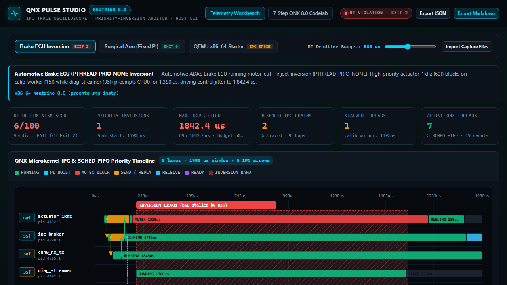
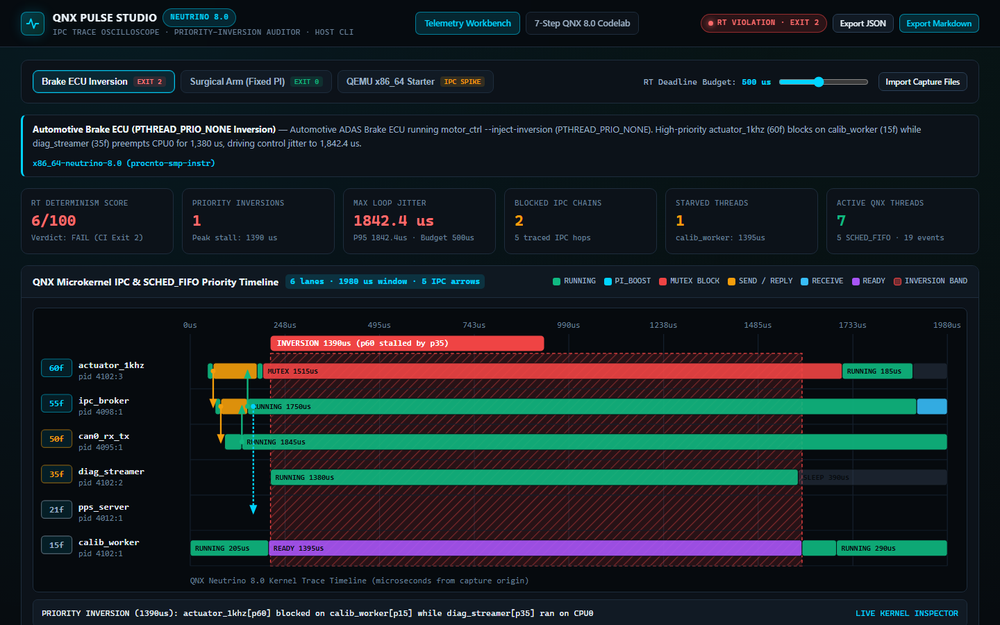
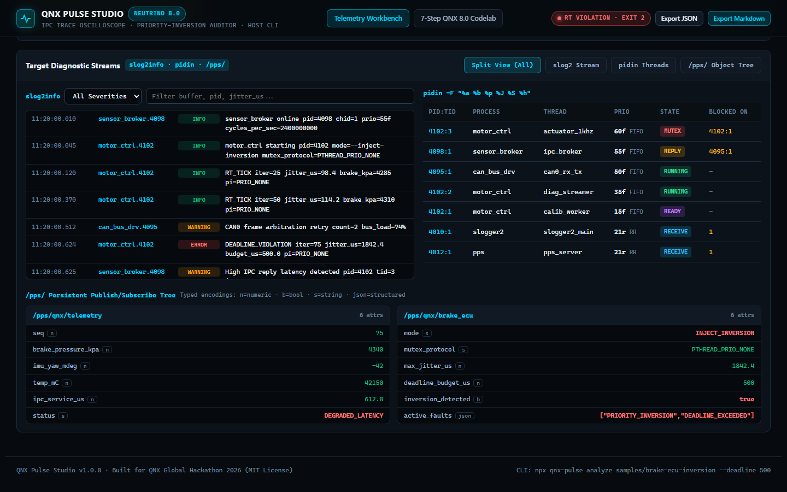
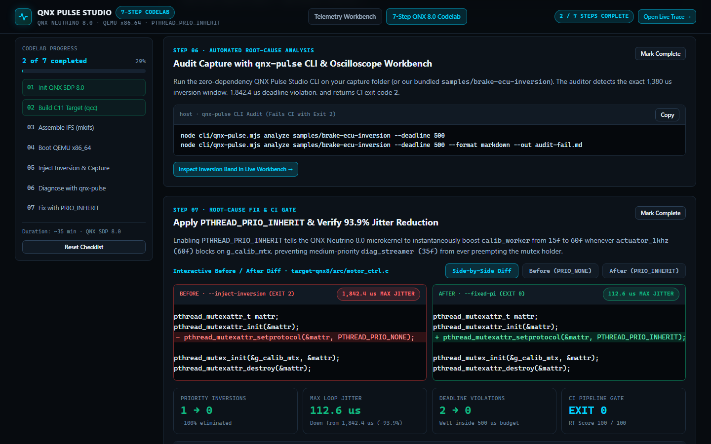

# QNX Pulse Studio

> **Deterministic Real-Time Diagnostics, Priority-Inversion Auditing, QNX 8.0 Target Reference & 7-Step Interactive Codelab**  
> Built for **QNX Global Hackathon 2026** (Targeting **Grand Prize**, **Developer Tooling & Host Tools**, and **Best Codelab / Tutorial**).

[](./LICENSE)
[](./target-qnx8)
[](./cli/qnx-pulse.mjs)



## Why QNX Pulse Studio Exists

Debugging hard real-time timing faults on **QNX Neutrino 8.0** typically forces engineers to bounce between four disconnected outputs: `slog2info` logs, `pidin -F` thread/priority snapshots, `tracelogger` / `traceprinter` kernel traces, and `/pps/` Persistent Publish/Subscribe state trees. When a 1 kHz automotive or robotics control loop blows its 500 us deadline budget due to an unexpected priority inversion or synchronous `SEND`/`REPLY` IPC stall, correlating those four streams manually takes hours.

**QNX Pulse Studio** unifies the entire loop — from target C11 code running on QNX 8.0 (`procnto-smp-instr`) to a zero-dependency cross-platform host CLI for CI/CD gating (`exit 0` PASS / `exit 2` RT violation), an interactive browser oscilloscope workbench, and a hands-on 7-step QNX 8.0 Codelab.

---

## What Is Inside

| Layer | Location | Highlights |
| --- | --- | --- |
| **QNX 8.0 C11 Target Project** | [`target-qnx8/`](./target-qnx8) | `sensor_broker.c` (`name_attach`, `MsgReceive`/`MsgReply`, `MsgSendPulse`, `ClockCycles`, `SYSPAGE_ENTRY(qtime)->cycles_per_sec`, `SCHED_FIFO`, `/pps/qnx/telemetry`) + `motor_ctrl.c` (1 kHz hard-RT loop with `--inject-inversion` vs `--fixed-pi` using `PTHREAD_PRIO_INHERIT`), `Makefile`, `CMakeLists.txt`, `qnx8-toolchain.cmake`, `qnx8-qemu-x86_64.build`, QEMU scripts & `capture-diag.sh`. |
| **Host Analyzer Core & CLI** | [`src/`](./src) + [`cli/qnx-pulse.mjs`](./cli/qnx-pulse.mjs) | Zero-dependency ESM parsers for `slog2info`, `pidin -F`, `traceprinter` CSV/native traces, and `/pps/` objects. Detects **Priority Inversions**, **Blocked `SEND`/`REPLY` IPC Chains**, **Hard-RT Deadline Jitter Violations (`>500us`)**, and **Thread Starvation** with CI exit codes (`0` / `2`) and JSON/Markdown reports. |
| **Live Web Workbench** | [`public/index.html`](./public/index.html) | Industrial RTOS Oscilloscope UI with interactive SVG `SCHED_FIFO` Microkernel IPC & Priority Timeline (`SEND`/`REPLY`/`PULSE` arrows + crimson Priority Inversion bands), filterable `slog2` stream, `pidin` thread table, `/pps/` object tree inspector, drag-and-drop capture importer, and 1-click JSON/Markdown audit export. |
| **7-Step QNX 8.0 Codelab** | [`CODELAB.md`](./CODELAB.md) & [`public/codelab.html`](./public/codelab.html) | Step-by-step hands-on tutorial from `qcc -Vgcc_ntox86_64` and `mkifs` to QEMU x86_64 boot, reproducing a real 1,842 us priority inversion, fixing it to 112 us with `PTHREAD_PRIO_INHERIT`, and gating CI pipelines. |

---

## Architecture

```
+-----------------------------------------------------------------------------+
|                    QNX Neutrino 8.0 Target (QEMU / Hardware)                |
|  motor_ctrl (1kHz SCHED_FIFO p60) <---MsgSend/Reply---> sensor_broker (p55) |
|         |                                                      |            |
|   g_calib_mtx (--inject-inversion vs --fixed-pi)        /pps/qnx/telemetry  |
|         +-------------> capture-diag.sh (slog2info, pidin, tracelogger)     |
+-----------------------------------------------------------------------------+
                                      |
                                      v  Capture Bundle (.log, .txt, .csv, .pps)
+-----------------------------------------------------------------------------+
|                  QNX Pulse Studio Core Engine (Zero-Dep ESM)                |
|   parsers.js (slog2 | pidin | traceprinter | PPS) -> analyzer.js            |
|   Detects: Priority Inversion | IPC Chains | Jitter >500us | Starvation     |
+-------------------------------+---------------------------------------------+
                                |
          +---------------------+---------------------+
          v                                           v
  Host CLI (cli/qnx-pulse.mjs)             Web Workbench (public/index.html)
  - Terminal / JSON / Markdown             - SVG Microkernel IPC Timeline
  - CI Gate: exit 0 PASS / exit 2 FAIL     - Live slog2, pidin, PPS Inspector
                                           - 7-Step Interactive Codelab
```

---

## Quick Start (Host CLI & Tests)

Requires **Node.js >= 18** (zero npm dependencies to install):

```bash
# 1. Run full unit & CLI verification suite
npm test

# 2. Audit an automotive Brake ECU capture with an active Priority Inversion (exits 2)
npm run audit:ecu

# 3. Audit the Surgical Arm capture after applying PTHREAD_PRIO_INHERIT (exits 0)
npm run audit:clean

# 4. Generate a Markdown or JSON RT audit report for CI artifacts
node cli/qnx-pulse.mjs analyze samples/brake-ecu-inversion --deadline 500 --format markdown --out audit-report.md

# 5. Launch the local interactive Web Workbench & 7-Step Codelab
npm run dev
# Open http://127.0.0.1:4173/ and http://127.0.0.1:4173/codelab.html
```

---

## Building & Running the QNX 8.0 Target (QNX SDP 8.0 + QEMU x86_64)

Follow [`CODELAB.md`](./CODELAB.md) or run directly after sourcing QNX SDP 8.0 (`source ~/qnx800/qnxsdp-env.sh`):

```bash
cd target-qnx8
make all                 # Cross-compiles sensor_broker and motor_ctrl via qcc -Vgcc_ntox86_64
make ifs                 # Assembles bootable build/qnx8-pulse-x86_64.ifs via mkifs
sh scripts/run-qemu.sh   # Boots QNX 8.0 procnto-smp-instr on QEMU x86_64
```

Inside the QNX 8.0 QEMU shell:

```sh
# Reproduce the Priority Inversion (PTHREAD_PRIO_NONE -> max jitter ~1,842 us)
/proc/boot/motor_ctrl --inject-inversion &
/proc/boot/capture-diag.sh /tmp/capture-inversion 3

# Apply the Priority Inheritance fix (PTHREAD_PRIO_INHERIT -> max jitter ~112 us)
/proc/boot/motor_ctrl --fixed-pi &
/proc/boot/capture-diag.sh /tmp/capture-fixed 3
```

---

## Screenshots

| IPC & Priority Inversion Timeline | `slog2` + `pidin` + PPS Inspector | 7-Step Interactive QNX 8.0 Codelab |
| :---: | :---: | :---: |
|  |  |  |

---

## License

Released under the [MIT License](./LICENSE).
